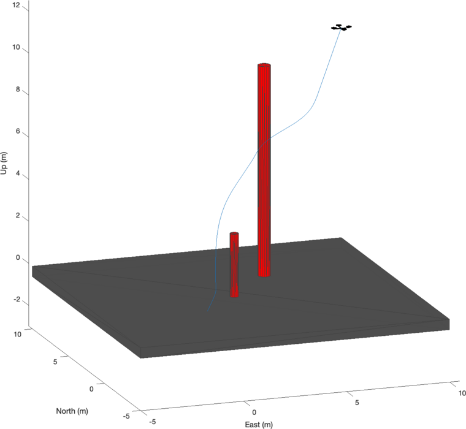
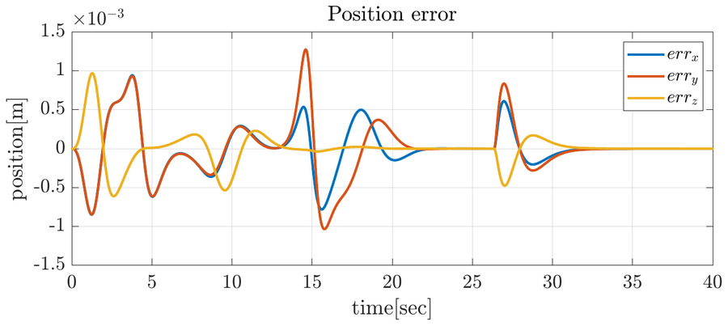
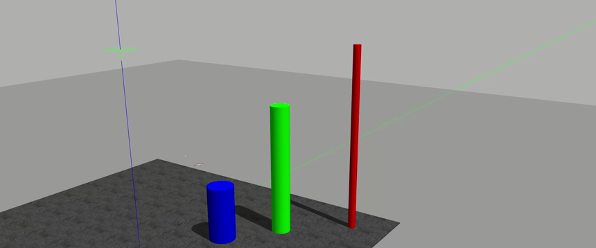

# Geometric control and artificial potential fields for a quadrotor UAV

<p align="center"></p>

A quadrotor that flies to a goal while avoiding obstacles: a **geometric controller on SO(3)** tracks the
reference produced by an **artificial potential field (APF)**, and a **momentum-based estimator** of the external
wrench corrects the mass used by the controller. The method is validated in MATLAB/Simulink and then in
ROS/Gazebo with the [RotorS](https://github.com/ethz-asl/rotors_simulator) simulator, where the APF also runs online
on the point cloud of a LiDAR.

Final project of the **Field and Service Robotics** course (Prof. Fabio Ruggiero), M.Sc. in Automation Engineering
and Robotics, University of Naples Federico II, academic year 2023/24.
Authors: **Stefano Riccardi** and **Gaetano Torella**. Full report: [docs/report.pdf](docs/report.pdf).

## Method

- **Geometric control.** An outer loop turns the position error into the desired thrust and attitude; an inner
  loop tracks the attitude on SO(3) and computes the torques. Working on rotation matrices avoids the
  singularities of Euler angles.
- **Artificial potential field.** The goal attracts the UAV and every obstacle repels it within an influence
  distance; the total force is used as the velocity that moves the reference. The obstacles are discretised into
  points on their surface. Three versions:
  - *waypoints*: the APF is integrated offline into timed waypoints, and a minimum-jerk trajectory through them is
    the reference of the controller;
  - *in the loop*: the APF is evaluated at every step of the simulation from the current position. It gives
    similar results, but it is the version that can run online, so it is the one ported to ROS;
  - *online* (ROS only): the repulsive force is computed from the LiDAR points closer than the influence distance,
    so the obstacles do not need to be known in advance.
- **Momentum-based estimator.** An estimator of order r (gains from a Butterworth filter) reconstructs the external
  force and torque. In this project it is used to estimate the real mass of the UAV.

## Results

**MATLAB/Simulink.** Quadrotor of 1.52 kg from (0, 0, 0) to (10, 10, 10) m around two cylindrical obstacles. With
the APF in the loop, the position error of the geometric controller stays around a millimetre:

<p align="center"></p>

**ROS/Gazebo (RotorS, AR.Drone model).** The controller sends roll, pitch, yaw rate and thrust commands to RotorS.

<p align="center"></p>

- With the nominal mass of 1.5 kg the position error keeps a constant offset. The estimator gives a real mass of
  about **1.63 kg**; with this value the steady-state error goes to zero.
- Online APF: the UAV avoids the obstacles it sees with the LiDAR. As with every potential field, it can stop in a
  **local minimum** where the attractive and repulsive forces cancel out; the report shows one such case.

Offline APF in Gazebo:

https://github.com/user-attachments/assets/4994c09c-fcf5-4eb4-8782-62c19b83f6e6

Online APF with the LiDAR (Gazebo on top; onboard camera and point cloud in RViz below):

https://github.com/user-attachments/assets/fe69edc4-9da9-4946-91f7-0fea17f3d348

## Repository structure

```
├── matlab/
│   ├── apf_waypoint_offline/   Simulink: APF waypoints + minimum-jerk trajectory
│   ├── apf_offline/            Simulink: APF evaluated in the loop
│   ├── estimator/              momentum-based estimator on a ROS bag (mass estimation)
│   └── rosbag_plots/           plots of the ROS/Gazebo experiments from a ROS bag
├── ros/
│   ├── geometric_controller/   ROS package: controller, APF (offline/online), estimator, UAV model, worlds
│   ├── xbox_controller/        gamepad teleoperation (optional)
│   └── mav_comm, octomap_ros, rotors_simulator   (git submodules)
└── docs/                       report and images
```

## MATLAB/Simulink

Requirements: MATLAB and Simulink with UAV Toolbox, Robotics System Toolbox and ROS Toolbox.
<!-- TODO: MATLAB version used -->

Open MATLAB in one of the folders of `matlab/` and run its script: `apf_waypoint_offline_script.m`,
`apf_offline_script.m`, `estimator_script.m` or `plot_rosbag.m`. The last two read a ROS bag recorded in Gazebo:
`UAV.launch` (see below) records it in `~/geom_controller.bag`; copy it into the folder of the script.

## ROS/Gazebo

Tested on Ubuntu 20.04 with ROS Noetic and `catkin_tools`.

```bash
cd ~/catkin_ws/src
git clone --recursive https://github.com/gaetanotorella/uav-geometric-control-apf.git
cd ~/catkin_ws && catkin build && source devel/setup.bash
```

1. Gazebo and the UAV (default world: `APF_world`, the others are in `ros/geometric_controller/worlds`):
   ```bash
   roslaunch geometric_controller UAV.launch world_name:=APF_world
   ```
   This launch file also records the main topics in `~/geom_controller.bag` (arguments `bag_directory` and
   `bag_name`).
2. The geometric controller:
   ```bash
   roslaunch geometric_controller geometric_controller_apf.launch
   ```
3. The APF and the estimator, with the goal position:
   ```bash
   roslaunch geometric_controller apf_method.launch version:=offline x_goal:=0 y_goal:=0 z_goal:=2
   ```
   `version:=offline` uses the known obstacles, `version:=online` the LiDAR.

## References

- F. Furrer, M. Burri, M. Achtelik, R. Siegwart, *RotorS—A Modular Gazebo MAV Simulator Framework*, in Robot
  Operating System (ROS): The Complete Reference (Volume 1), Springer, 2016.
- A. Ma'Arif et al., *Artificial potential field algorithm for obstacle avoidance in UAV quadrotor for dynamic
  environment*, IEEE COMNETSAT, 2021.
- The full list is in the [report](docs/report.pdf).
